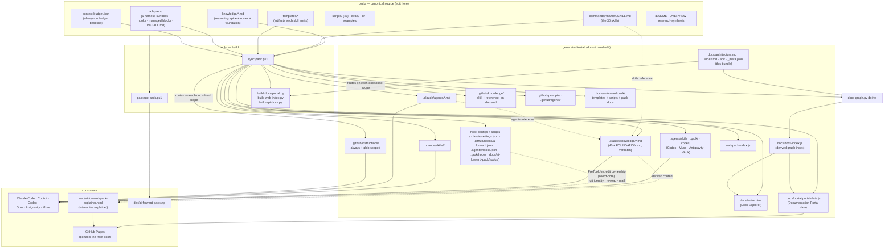
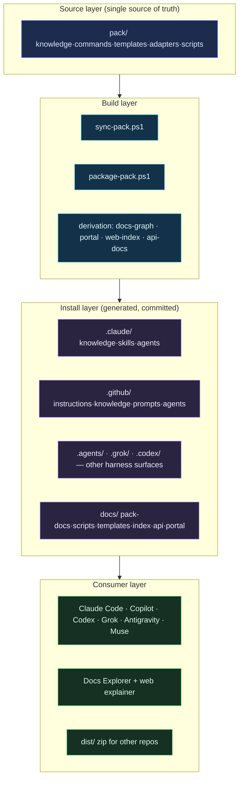
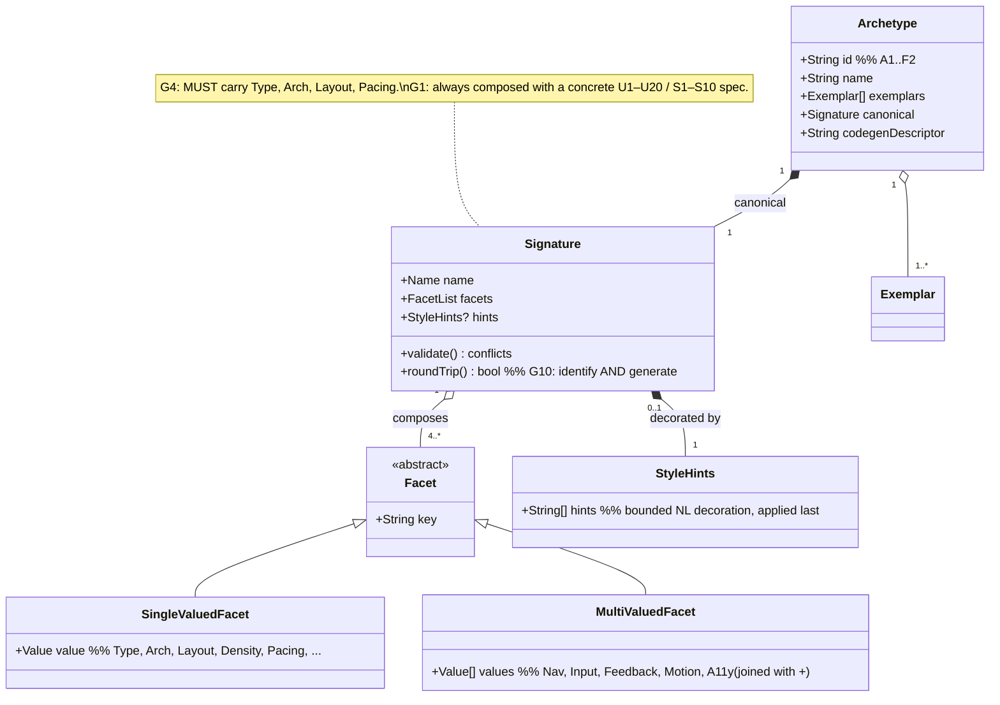

<!--
Produced by /document (Rigor Protocol run on the codebase as the subject of documentation).
Ground truth is the repository itself. Confidence labels: [Verified] traced to a file/run;
[Inferred] reasoned, not executed; [Flagged] carried as a risk. The documented commit and
coverage are in docs/_meta.json. This bundle is companion to the self-contained interactive explainer
web/ai-forward-pack-explainer.html.
-->

# Architecture: AI-Forward (pack source + live dogfood install)

- **Status:** Accepted
- **Tier:** N/A — this repository is a knowledge/tooling package with no inference client.
  The short-lived model-orchestration experiment was reverted after forensic review; model
  selection remains the host/user's responsibility. `[Verified]`
- **Driving context:** `README.md`, `CLAUDE.md`, `pack/OVERVIEW.md`
- **Documented commit:** see `docs/_meta.json`

## Context & constraints

This repository is **two things at once** (`README.md` §"This repo is two things at once"):

1. **The canonical source** of the AI-Forward Pack — everything you edit to expand the pack lives under `pack/`. `[Verified: README.md, pack/]`
2. **A live install of the pack** — the pack is installed into this same repo (`.claude/`, `docs/`) so the skills, agents, and knowledge are active in Claude Code *while you work on the pack itself*. Dogfooding: the pack is built using the pack. `[Verified: .claude/, CLAUDE.md]`

The load-bearing constraint that shapes the whole structure:

> **`.claude/` and `docs/` are GENERATED from `pack/`** by `tools/sync-pack.ps1` and committed so a fresh clone has a working install with no setup. `pack/` is the single source of truth — never edit the generated copies directly; they are overwritten on the next sync. `[Verified: CLAUDE.md, tools/sync-pack.ps1]`

Generated knowledge documents under `.claude/knowledge/` and `docs/ai-forward-pack/` carry **no YAML frontmatter** (they are vendored prose, not graph nodes). Project documentation under `docs/` is the graph authority; it contains **368 valid artifacts with no flagged, orphan, dangling, or index-drift findings, and 2 past their `review-by` date** (`audit-log`, `forensic-review-backlog-20260712`; V13). `[Verified: docs-graph.py inventory, pack revision 113, 2026-10-18]`

The pack ships to **six harness surfaces**: Claude Code (`.claude/`), GitHub Copilot (`.github/`),
Codex and Muse (`.agents/skills/`, plus `.codex/`), Grok Build (`.grok/`) and Antigravity
(`.agents/`). Each has an adapter under `pack/adapters/<harness>/`; no ADR records the
six-harness decision yet (FR-095). `[Verified: pack/adapters/, repo root]`

## Archetype & rationale

No LOA system archetype (A–I) applies — those classify AI-integrated *runtime* systems. The applicable shape here is a classic **source → build → install → consumer** pipeline with a **dogfood loopback**: the install layer feeds back into the authoring experience (Claude Code reads `.claude/` while you edit `pack/`). `[Inferred from repo structure]`

## Component map & boundaries

The major components and the real dependency edges between them (read from `tools/sync-pack.ps1`, `tools/package-pack.ps1`, and the directory layout):



Boundaries that matter:
- **Source ↔ install boundary** — crossed *only* by `tools/sync-pack.ps1`. Editing the install side directly is a contract violation (the next sync overwrites it). `[Verified: CLAUDE.md, sync-pack.ps1]`
- **`sync-pack.ps1` write scope** — `.claude/{knowledge,skills,agents}` and the hooks in `.claude/settings.json`, all four `.github/` surfaces plus `.github/hooks/ai-forward.json`, `.grok/{skills,agents,hooks,rules}`, `.agents/` (skills and `hooks.json`), `docs/ai-forward-pack/**` (hook scripts under `hooks/`), `docs/index.html`, and the CLAUDE.md / AGENTS.md managed blocks; `.codex/hooks.json` is refreshed only if it already exists (FR-096). It then **invokes the derivation tools**: `docs-graph.py derive` (with `--root`, so it derives this checkout whatever the caller's cwd — PLAT-E), `build-web-index.py`, `build-docs-portal.py`. `[Verified: tools/sync-pack.ps1]`
- **It does not write** `.claude/settings.local.json`, `.github/copilot-instructions.md`, or this bundle's hand-authored files (`docs/architecture.md`, `docs/index.md`), so they have a stable home. `[Verified: tools/sync-pack.ps1 header + body]`
- **Correction (2026-09-03).** This section previously stated that sync "intentionally does not touch `docs/docs-index.js`". That has been false since FR-060/FR-068 moved derivation *into* sync so the index could never lag a run that added an artifact. The index is still never hand-edited — it is derived from frontmatter — but sync is now one of the things that derives it.
- **Load-scope routing** — a knowledge doc reaches `.github/instructions/` only if its frontmatter says `load: always` or `load: glob`; `skill` and `reference` docs go to `.github/knowledge/` and are read on demand. This is what keeps the always-on prefix at ~51.0K (14 `load: always` docs) rather than ~184.1K estimated tokens. `[Verified: sync-pack.ps1 Get-LoadScope; context-budget.py report, 2026-10-18]`

## Key flow — the sandbox / dogfood loop (sequence)

The authoring loop from `README.md` §"Expanding the pack", with the graph-refresh step `/document` adds:

```mermaid
sequenceDiagram
  actor Dev as Author
  participant Pack as pack/ (source)
  participant Sync as tools/sync-pack.ps1
  participant Install as .claude/ + docs/
  participant CC as Claude Code (this repo)
  participant Graph as docs-graph.py
  participant Verify as tools/verify-bundle.ps1
  participant Explorer as docs/index.html
  participant GH as GitHub (main, protected)

  Dev->>Pack: edit a knowledge doc / SKILL.md / persona / template
  Dev->>Sync: pwsh tools/sync-pack.ps1
  Sync->>Install: mirror knowledge, skills, agents, templates, scripts
  Sync->>Install: route each knowledge doc by its load: scope<br/>(instructions vs .github/knowledge)
  Sync->>Install: re-paste the CLAUDE.md / AGENTS.md managed blocks
  Sync->>Graph: docs-graph.py derive
  Graph->>Install: write docs/docs-index.js from frontmatter
  Sync->>Install: build-web-index.py, build-docs-portal.py
  Note over Sync,Install: derivation runs INSIDE sync (FR-068), so the<br/>index can never lag a run that added an artifact
  Dev->>CC: try the change (regenerated skills/agents are now live)
  CC-->>Dev: run a skill; dogfood the edit
  Dev->>Verify: pwsh tools/verify-bundle.ps1
  Verify->>Verify: 18 gates — counts · portability · contracts · drift ·<br/>tests (xdist -n 4, then serial wallclock) · explorer ·<br/>graph · foundation · audit · coordination · evals · context budget
  Verify-->>Dev: PASS (~15 min), or the first thing that is wrong
  Graph->>Explorer: index loaded; hierarchy · graph · mind map · health render
  Dev->>Pack: commit pack/ + .claude/ + .github/ + docs/ together (lockstep)
  Dev->>GH: open a PR (direct pushes are rejected)
  GH->>GH: pack-consistency: consistency · consistency-windows ·<br/>consistency-macos (required, ~25 min) + duration-budget
  GH-->>Dev: rebase-merge once green and up to date with main
```

The gate is part of the loop, not an afterthought. Since 2026-10-18 `main` requires linear
history **and** the three `pack-consistency` checks, bound to the GitHub Actions app, with
`strict` up-to-date PRs, admins included; a red PR is `BLOCKED` (proved by PR #18).
`verify-bundle.ps1` runs the same gates locally in ~15 min and fails sooner than CI.
`[Verified: gh api …/branches/main/protection; tools/verify-bundle.ps1; .github/workflows/pack-consistency.yml; docs/notes/note-20261017-require-ci-before-merge.md]`

## Reverted model-orchestration experiment (historical)

Commit `5d7b952` added a global model-orchestration standard and static routing lookup. The
forensic review found that the capability was not wired into skills/personas, contradicted its
hard adversary-independence rule, could reduce T2 rigor, lacked behavioral proof/audit support,
and had no provider/data-governance boundary. The user chose removal rather than remediation.

The active architecture therefore has **no model-per-task control plane**. The existing
Orchestrator remains a process/persona facilitator only. The historical evidence and closed
findings remain in `docs/reviews/forensic-review.md`,
`docs/backlog/forensic-review.md`, and the superseded/accepted decision-note pair.

## Multi-harness coordination deep dive

The repo's multi-agent surface now has its own architecture/proof stack: worktree isolation,
artifact classes, Owner / Coordinator / Sub-Agent doctrine, the compile stage, `execute-with-coordination`
and the bounded runtime are documented in
[`architecture-multi-harness-coordination.md`](architecture-multi-harness-coordination.md).
That document is the deep narrative: where the design started, what was rejected, what shipped,
what remains profile-specific, and which negative proofs changed the design.

## Layered view (source → consumer)

The repo's own layering (distinct from the LOA *capability* tiers it ships as payload):



Dependency direction points **up only** (source → build → install → consumer); no consumer writes back into source except through the human author editing `pack/`. `[Verified: tools/*.ps1]`

## Domain model (class) — the UI Archetype Grammar

The most code-like structure in the repo is the **Archetype Grammar** (`ui-archetype-grammar.md` EBNF, G1–G16) and its catalog (`ui-archetype-catalog.md`). Documented here as a class model because it is the conceptual schema the experience and the codegen contract are built on:



`[Verified: ui-archetype-grammar.md §2 EBNF, G1/G4/G5/G10; ui-archetype-catalog.md]`

## Tool & CLI reference (the repo's public surface)

The **public surface is the deployed script bundle** — `pack/scripts/*.py`, which lands in every consuming repo as `docs/ai-forward-pack/scripts/`. That surface now has a generated JavaDoc-style reference at **[`docs/api/`](api/index.md)**, extracted from the modules' own docstrings and argparse definitions. Everything under `tools/` is repo-local build tooling and is deliberately *not* deployed. `[Verified: tools/, pack/scripts/, docs/ai-forward-pack/scripts/, tools/build-api-docs.py]`

| Command | Purpose | Notes |
|---|---|---|
| `pwsh tools/sync-pack.ps1` | Regenerate `.claude/`, `.github/`, and `docs/` from `pack/`. | Run after every `pack/` edit. Also runs `docs-graph.py derive`, `build-web-index.py`, and `build-docs-portal.py`. |
| `pwsh tools/package-pack.ps1` | Build `dist/ai-forward-pack.zip` for sharing. | Carries full Claude Code + Copilot wiring. |
| `pwsh tools/verify-bundle.ps1` | Run the complete **18-gate** local proof, matching CI's gate set. | Gate 2 synchronizes and compares generated surfaces (commit first: it is `git diff --exit-code`); gate 3 runs `pytest -n 4 -m "not wallclock"` then the `wallclock` tests serially when `pytest-xdist` is installed; gate 8 is the always-on context budget. ~15 min on a Windows dev box. |
| `python tools/check-test-counts.py --junit <xml> [--junit <xml>]` | Fail when pytest's collected count differs from the JUnit test cases. | CI runs it after both test stages, so a parallel run cannot silently drop a test. |
| `python tools/ci-duration-budget.py …` | Per-job wall-clock against the trailing median of green `main` runs. | The non-required `duration-budget` job; fails above 1.5×, reports "not enough history" below 5 comparable runs. |
| `python tools/build-api-docs.py [--check]` | Generate `docs/api/` from `pack/scripts/`. | `--check` is the drift gate; prose comes only from source docstrings, gaps are recorded not invented. |
| `python pack/scripts/context-budget.py <cmd>` | The always-on context budget: `report`, `gate`, `agents`, `preflight`. | Ratchets against the baseline in `pack/context-budget.json`. |
| `python tools/new-capability.py ...` | Scaffold a skill or knowledge extension across source surfaces. | Used by `/extendaibundle`. |
| `python tools/check-consistency.py` | Check counts, skill/prompt parity, prose drift, deployed-agent parity, proof coverage, workflow pinning, review currency, and derived-artifact drift. | Reads `pack/` as the source of truth and fails closed on mismatches. |
| `python docs/ai-forward-pack/scripts/docs-graph.py <cmd>` | The knowledge-graph mechanics (V18). | Stdlib-only Python 3.8+. |

`docs-graph.py` subcommands (`[Verified: --help]`): `inventory` (scan the graph → JSON), `derive` (frontmatter → `docs/docs-index.js`), `validate` (inventory + nonzero exit on findings, CI-able), `freshness` (stale + flagged + orphans gate), `flag` / `clear-flag` (V16 review propagation), `stub` (scaffold a schema-correct artifact), `snapshot` (append a graph-health record), `rollup` (aggregate per-design STRIDE / privacy tables into a register), `context` (a bounded context pack traversed from one artifact: `--id`, `--hops`, `--max-bytes`).

## Cross-cutting concerns

- **Identity & trust boundaries:** no auth surface of its own, but the pack **does** run at the
  agent's tool seam. PreToolUse hooks decide edits (`coord-core.py hook`: lease ownership). On
  Claude the hook never asks (`note-20261019-edits-never-ask`, revision 114): `allow` for a checked
  free or own path, `deny` for a held lease or a suspect path, and no decision otherwise, including
  outside the repo (WT-E/WT-E2). The native hosts refuse what they cannot check (FR-100). The hooks
  also refuse git-identity forgery, judged on command words (`git-identity-guard.py`, FR-088
  resolved). Byte code is cached per user (FR-086 resolved). Open trust findings from the
  revision-108 review: link-following writes (FR-092), setup from mutable `main` (FR-093),
  executable `session-checks.json` (FR-098). `[Verified: .claude/settings.json; pack/adapters/hooks/; docs/backlog/forensic-review-rev108.md]`
- **Failure & resilience:** the build tools are the only runtime besides the hooks; `sync-pack.ps1` is idempotent (it mirrors source over install each run) and derives with `--root`. The guard hooks (git identity, re-read) fail open on an unreadable payload; the edit-ownership hook never prompts on Claude: a check it cannot run gets no decision, so the session's mode decides, and a suspect path gets `deny`. The native hosts fail closed with `deny`. `[Verified: sync-pack.ps1; git-identity-guard.py:105; coord-core.py cmd_hook]`
- **Observability:** the audit log records every skill run with measured `duration_seconds`; the hook dispatcher can time itself into `hook-times.jsonl` (revision 110); CI records per-job durations against a trailing median (`duration-budget`). `[Verified: audit-log.py; dispatch.py; pack-consistency.yml]`
- **Data governance / privacy:** no personal data is stored or processed by the tools. Session profiles under `docs/profiles` are published by the owner's ruling (`note-20261017-session-profiles-published`). `[Verified]`

## Flagged risks & residual unknowns

- **`[Resolved 2026-06-22; reverified 2026-07-12]` Knowledge graph populated; vendored foundation docs deliberately excluded (decision).** The graph holds the project's dogfood artifacts while vendored foundation/standards docs deliberately stay out: they deploy as *always-applied reference instructions*, not parallel graph authorities. `[Decision recorded per BoK Part IX / V17; pre-review inventory = 22 artifacts, 0 problems/stale/flagged/orphans/drift]`
- **`[Resolved]` Archetype count corrected (16, not 18).** `CLAUDE.md`, the managed blocks (`CLAUDE.block.md`, `AGENTS.block.md`), `pack/OVERVIEW.md`, `pack/README.md`, and `pack/adapters/INSTALL.md` previously said **"18-archetype catalog"**, but `ui-archetype-catalog.md` enumerates **16** (A1–A4, B1–B4, C1, D1–D3, E1–E2, F1–F2). All source occurrences were corrected to 16 and the install re-synced from `pack/` (the grammar doc itself never stated a count). `[Verified: ui-archetype-catalog.md count = 16; grep shows no remaining "18-archetype" in source]`
- **`[Verified-headless 2026-06-22]` Explainer statically verified; live visual pass still advisable.** `web/ai-forward-pack-explainer.html` passed a thorough headless check: its single inline app (~67 KB) **parses cleanly under `node --check`**, mounts to a `#root`, renders via `ReactDOM` (`createRoot`/`render`), and carries a CDN **offline-fallback guard**; it mirrors the proven `docs/index.html` (React 18 UMD + htm, no JSX/babel) pattern. The parse/structure failure risk is retired; a quick **visual** pass in a real browser remains nice-to-have before any public share (cosmetic only — cannot be done headless). `[Verified: node --check OK; mount + ReactDOM + offline guard present]`

## Status & next action

| | |
|---|---|
| **Completed** | Architecture overview + 4 diagram families; tool/CLI reference; interactive explainer; MoC index; `_meta.json`; `docs-index.js` regenerated; findings recorded. **2026-06-22 audit:** design-doc status tables refreshed (rev-8 Doc Drift), `project-memory` ledger instantiated, explainer headless-verified, knowledge-docs-in-graph decision recorded. |
| **2026-10-18** | Re-verified at revision 113: counts, six harness surfaces, sync scope, 18 gates, the required-check workflow, the hook trust seam. CI-speed plan P0–P9 executed (`plan-ci-speed-and-required-checks`). |
| **Remaining** | Revision-108 backlog (`forensic-review-rev108-backlog`): the P2s are closed (FR-086 and FR-088 in revision 114, FR-089 by owner ruling); P3s FR-090–FR-100 less those resolved. FR-087 (manual-only CI) is resolved by CI-speed P5. FR-099 (environmental test failures) is partly resolved: the `AGENT_SESSION` leak is fixed for every test, and since revision 110 the symlink and `uv` tests pass or skip on the owner's machine, but no general skip guard exists for a host without symlink privilege or `sh`. Two artifacts are past `review-by` and keep the `docs` workflow red until reviewed. |
| **2026-10-19** | Revision 114: edits never ask (EDIT-ASK), git-identity guard on command words (FR-088), per-user byte-code cache (FR-086). |
| **Best next action** | Write the six-harness ADR (FR-095); triage the rev108 P3s. |

## Gate record

`GATE document · 2026-06-14 · Documentation Steward (peer→adversary), Patterns Expert, Enterprise Architect, Simplifier · diagrams verified node-by-node against repo structure; CLI verified against --help; discrepancies recorded not hidden · verdict: pass with flagged findings · author did not self-clear`

`GATE document · 2026-10-18 · revision 113 · every changed count, path, gate and protection claim re-measured (check-consistency, docs-graph inventory, context-budget report, sync-pack.ps1, dispatch.py ROUTES, gh api protection); the author's own check caught one drafted error (the ownership hook fails closed, not open) and introduced another (it struck `.github/hooks` from the sync scope; sync writes `.github/hooks/ai-forward.json`) · adversary: Documentation Steward, independent sub-agent — caught that error, the per-host outside-repo behaviour, and FR-087/FR-099 overstated; all fixed · Mermaid read, not rendered here · verdict: pass with findings (FR-095, two stale review-by dates) · author did not self-clear`

---
**Handoff:** → onboarding, review, and `/define-architecture` (these diagrams are the architecture of record). Runs continuously via the freshness trigger.
