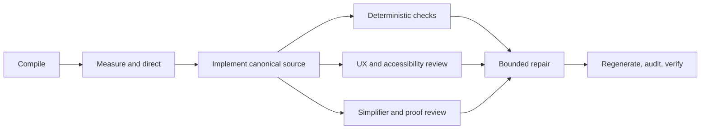

# GitHub Pages UI elevation execution graph

## Grounding and triage

The request is T2. It has a generated public surface, a visual review gate, an
accessibility hard veto, a repair loop, and repository-wide drift gates. Planning is
therefore required (GO16).

Graph traversal: `design-reader-first-handbook` → `refines` →
`spec-documentation-portal` → `depends-on` → `design-language-docs-explorer`. The
accepted reader-first contract narrows the work to the public handbook sources in
`web/handbook/` and their derived `docs/portal/` output. The older catalogue portal
remains secondary.

## Direction fixed before execution

- Goal: elevate the AI-Forward GitHub Pages handbook with useful diagrams and a more
  polished, coherent reading experience.
- Done when: canonical source, generated surface, design language, review evidence,
  accessibility verdict, and repository gates agree.
- Not in scope: product behavior outside the public documentation site.
- Trigger map: UI-T1 does not fire (not an expert quantitative workbench); UI-T2 does
  not fire (no generated imagery); UI-T3 does not fire (the page documents AI but does
  not front a model); UI-T4 does not fire (static web, not a native client).
- Archetype: learning guide plus searchable reference; `F1 Content Portal` with a
  reading-first three-region layout. Reading stays serial; discovery remains parallel.

## Optimized graph

| Node | Goal | Inputs | Exit condition | Tier | Capability | Dependencies |
|---|---|---|---|---|---|---|
| N0 | Compile and gate the request | raw prompt | dispatchable compiled brief, no open DR | T0 | Deterministic mechanics | — |
| N1 | Measure the current public surface and trace its sources | compiled brief, spec, design, source, generated page | baseline counts, surface inventory, direction brief, and graph trace recorded | T1 | Reasoning | N0 |
| N2 | Implement the shared visual system and semantic diagrams in canonical sources | N1 evidence, `web/handbook/DESIGN.md` | source changes build deterministically and cover the selected diagrams and hard states | T2 | Reasoning | N1 |
| N3a | Run deterministic source, browser, craft, and build checks | N2 tree | each declared oracle passes and its output is read | T0 | Deterministic mechanics | N2 |
| N3b | Review rendered desktop/mobile/light/dark/error states | N2 build and captures | independent UX & Accessibility PASS or precise BLOCK predicate | T2 | Independent review | N2 |
| N3c | Attack IA, excess, and proof sufficiency | N2 tree and review draft | Simplifier delete-list and Test Architect verdict | T1 | Independent review | N2 |
| N4 | Repair supported blockers and major findings | N3a–N3c findings | unresolved actionable blocker/major count strictly decreases to zero | T2 | Reasoning | N3a, N3b, N3c |
| N5 | Regenerate, sync graph, audit, and run the bundle gate | repaired source and artifacts | derived outputs are current; full gate is green and its state is read | T0 | Deterministic mechanics | N4 |

## Edge and concurrency analysis

All drawn edges are data or decision edges. The order among N3a, N3b, and N3c was
incidental and has been deleted. Those nodes share a read-only built tree, produce
separate evidence, and hold no exclusive resource, so they pass the independence test.
Their review contexts are loosely coupled, which justifies width three.

Fan-out contract: width cap 3; retry one transient tool failure; each branch exits with
file- or render-backed findings and a verdict; the join accepts partial evidence only
when the failed branch is rerun inline; branches are read-only; termination is one
review pass; deadline is this skill run; fallback is the same review inline.

Naive graph: 9 serial nodes, work `T1 = 9` units, span `T∞ = 9`, width 1. Optimized
graph: 8 nodes, modeled work `T1 = 8` units, modeled span `T∞ = 6`, width 3. With three
workers the modeled ceiling is `(8 - 6) / 3 + 6 = 6.67` units. These figures are
**Inferred** from node counts; no duration claim is made. The plan shortens the span
before widening it by collapsing direction and inventory into one evidence node and
pulling all review gates directly after the first build.

Deterministic share rises from an inferred 2/9 to 3/8 nodes. Rigor floors remain:
settled UX, E7 source-to-render trace, hard states, independent accessibility review,
craft detection, reader/browser proof, derived-artifact drift, docs graph, and audit.

## Oracles and transcription width

| Surface | Fails when |
|---|---|
| Canonical handbook source | the visual contract exists only in generated HTML or a diagram lacks a textual equivalent |
| Generated portal | rebuilding changes a second time, source edits are absent, or a hard state cannot be rendered |
| Accessibility | keyboard route, focus, target size, contrast, reduced motion, or equivalent diagram text fails |
| Content/IA | the landing path stops being problem-led or a diagram duplicates prose without clarifying a relationship |
| Repository | counts, published boundary, pack copies, graph index, or required tests drift |

The scan-shaped guards are bounded to `web/handbook/`, its derived
`docs/portal/index.html`, the relevant docs artifacts, and the repository's existing
verification roots. Their token set is the detector/test inventory; generated vendor
code and declared derived data remain on the existing allowlists. These clauses are
jointly satisfiable because canonical sources own presentation and generation owns
only the derived copy.

## Repair loop

- Variant: count of supported unresolved Blocker/Major findings.
- Floor: zero.
- Exit: zero supported Blocker/Major findings and all deterministic oracles pass.
- Cap: two repair passes. Hitting the cap is a defect signal and is reported; it is not
  treated as evidence of completion.

## Budget and replanning

Main-line budget: one evidence pass, one implementation pass, and one bounded repair
pass, with a second repair pass available only for newly exposed gate failures. The
degradation path keeps every gate and narrows decorative scope before diagrams,
accessibility, or source/generated consistency. Replan after N1 if the published front
door differs from the handbook contract, and after N3 if an independent veto changes
the implementation shape.

## Planned versus actual

All eight planned nodes ran. N3a, N3b, and N3c overlapped at the declared width of
three: the main line ran deterministic checks while two independent reviewers held the
UX/accessibility and simplification/proof seats. No branch was abandoned or retried for
a transient failure.

The implementation used both available repair passes. The first closed craft and proof
findings. The second repaired a visually detected diagram overflow and the final mobile
navigation findings, then reran the exact browser and independent-review oracles. The
cap therefore fired as a defect signal; it was not used as a reason to stop. The
overflow exposed a missing geometry oracle, which is now asserted at desktop and mobile
and recorded under defect class E2E-C.

Measured elapsed time from the audit start marker through final graph validation was
2,499 seconds. The closing audit entry records the exact end-to-end duration when the
marker is consumed. The final span includes 33 browser checks across three engines,
4 build/drift checks, design lint, craft detection, independent veto review, docs-graph
derivation and validation. The repository bundle gate remains the authoritative outer
join; its terminal output and commit verification hold that result rather than this
plan predicting it.

Every immovable floor passed: the source-to-render trace is intact; the public and
review artifacts are byte-identical; all hard states remain reachable; diagram source
is escaped; accessibility veto is clear; the craft detector has no Major or Blocker;
the docs graph has zero defects, suggestions, stale entries, flags, or orphans. The
final fan-out matched the cap and the modeled eight-node graph matched the actual graph.
