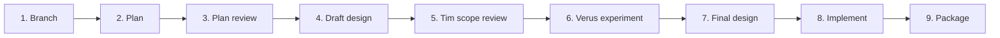

# Optional Formal Verification: Implementation Plan

## Summary

This plan explains how we get from the merged
[specification](../specs/optional-formal-verification.md) to a working feature.

- **Done:** the contribution branch is set up, and a
  [proposed design](../design/optional-formal-verification.md) is written and
  independently reviewed.
- **Waiting on Tim:** the specification asks Tim to accept or revise its scope.
  He has not done that yet, so implementation cannot start.
- **Next:** open a draft PR from Lucio's fork so Tim can review the scope and
  the proposed design together.
- **After Tim decides:** run a small experiment to confirm that Verus works the
  way the design assumes. Then finish the design and build the feature.

Nothing has been installed, run, or implemented yet.

### Terms used in this plan

- **Verus:** a tool that checks, mathematically, that Rust code meets a
  written contract.
- **Contract:** a precise statement of what a function must do, such as "accept
  a range only if it fits inside the buffer."
- **Obligation:** one claim the verifier is asked to check.
- **Proof Pack:** AI-Forward's existing record of what was claimed, how it was
  checked, and what risk remains.
- **Qualification experiment:** a small, throwaway test that confirms one exact
  Verus version works in one approved environment before we design around it.
- **Stale result:** a verification result whose inputs (code, contract or tool
  version) have changed since it ran, so it no longer counts.

## Who Decides What

The specification is merged but not yet accepted. Its gate record says:
"Human acceptance: Pending Tim's review. No implementation, toolchain
installation, commit, push, or PR is authorized by this document." It also says
`/implement` runs only "after the scope is approved and Verus is available in
an approved environment."

Merging made the specification available to experiment with. It did not
answer the four decisions the specification asks Tim to make:

1. the opt-in boundary (verification stays off unless chosen);
2. Verus as the first and only verifier;
3. the evidence requirements;
4. the worked example (a synthetic validator first; OpenVMM later, if at all).

What this means in practice:

| Activity | Allowed now? |
|---|---|
| Drafting and reviewing the design | Yes. Lucio asked for it, and nothing in the specification blocks it. |
| Opening a draft PR for review | Yes. This is how Tim sees the proposal. |
| Installing Verus or running experiments | No. Waits for Tim's scope decision and an approved environment. |
| Implementation | No. Waits for Tim's scope decision, the experiment, and the final design review. |
| Changing the scope, such as replacing the synthetic example with OpenVMM | Only if Tim approves a specification change. |

Tim decides scope. Routine technical choices belong in the design and do not
need his approval one by one. Existing tests and reviewer checks still apply.

## The Steps

| # | Step | What it produces | Finished when | Status |
|---|---|---|---|---|
| 1 | Set up the branch | A branch in Lucio's fork, based on Tim's latest `main` | Branch matches upstream; pushes go to the fork | Done |
| 2 | Write this plan | This document | Steps, decisions and checks are written down | Done |
| 3 | Independent plan review | Astra review of this plan | Findings handled | Done: no substantive findings |
| 4 | Draft the design | [Proposed design](../design/optional-formal-verification.md) | Astra reviewed it; findings fixed and rechecked | Done: one major finding fixed and rechecked |
| 5 | Tim's scope review | Draft PR with this plan and the design | Tim accepts or revises the scope | **Next** |
| 6 | Qualification experiment | Evidence that one Verus version works as assumed | A correct example passes and a broken example fails | Not started |
| 7 | Finalize the design | Accepted design and decision record | Required reviewers find no blocking issues | Not started |
| 8 | Implement | Code, tests and examples, built test-first | The Proof Pack correctly accepts or rejects real results | Not started |
| 9 | Package and release | Updated AI-Forward pack for both Claude and Copilot | Sync and bundle checks pass; live demo evidence attached | Not started |

The steps run in order. Each step depends on the one before it, so running
them in parallel would not save time.

## Step 6: The Qualification Experiment

The goal is to learn whether Verus actually checks what the design assumes,
before we build anything around it. It does not deliver the feature.

1. **Pick the environment.** Record one approved operating system, Verus
   version, Rust toolchain and solver. Do not assume Windows works just because
   this planning ran on Windows. Installing anything needs separate permission.
2. **Write the example.** Use a tiny Rust function that checks whether a
   requested range fits inside a buffer. Write its contract first, including
   which inputs are valid and which are rejected. The contract must require
   valid inputs to be accepted, so a function that rejects everything cannot pass.
3. **Set limits.** Choose a time and resource limit before running. Check the
   real Rust code, not a separate model of it.
4. **Run it both ways.** The correct version must pass. Then introduce a
   deliberate bug, such as changing `<=` to `<`, and confirm that it fails
   against the same, unchanged contract. A zero exit code or a "passed" count
   alone is not proof; confirm which obligations were actually checked.
5. **Record what happened.** Keep the inputs, versions, command, output and
   duration. If Verus was unavailable, unsupported or inconclusive, say so.

If the experiment cannot be completed, report it as blocked. Do not mark the
design ready.

## What the Finished Feature Must Do

These rows summarize the specification's acceptance criteria (FV-01 to FV-18
and UX-01 to UX-04).

| Criteria | Requirement in plain terms |
|---|---|
| FV-01 to FV-03 | When verification is off, nothing changes: no Verus checks, installs or extra files. Declined, non-Rust and unsupported work is labeled as such. |
| FV-04 to FV-06 | Each claim links to a requirement and is written in English, with examples, assumptions and a named reviewer. If the meaning or the trusted assumptions change, the claim goes back for review. |
| FV-07 to FV-09 | Results use seven distinct outcomes: passed, failed, inconclusive, unavailable, unsupported, cancelled, not run. Timeouts, crashes, empty output and wrong-scope output are never reported as passed. |
| FV-10 to FV-12 | A result is current only if the code, contract, dependencies, tool versions and settings still match. A mismatch makes it stale; missing information makes it unknown. Old results are kept, not overwritten. |
| FV-13 to FV-15 | Existing tests and reviews still apply. No automatic uploads, installs, credential use or elevated permissions. No new mandatory review panel. |
| FV-16 to FV-18 | A live demo shows the correct example passing and the broken example failing. Tests cover unavailable tools, interruptions, empty checks and stale results, on every supported host. |
| Evidence storage | An interrupted write never looks like complete evidence. Two runs at once are refused rather than mixed. |
| UX-01 to UX-04 | Output shows the outcome and claim first, lists assumptions together, explains failures and next actions, and never implies the whole feature is approved. |

Simulated test output checks the plumbing; it cannot replace the live demo.

## Files Likely to Change

The design decides exact names. Expected areas:

- existing `/design-slice` and `/implement` guidance, which loads formal
  verification only when it is chosen;
- a small helper script, only if the experiment shows one is needed;
- the synthetic example and its tests;
- the Proof Pack template and the code that reads it;
- installation metadata and the generated copies of the pack.

Pack changes are made in `pack/`, follow `/extendaibundle`, update the revision
notes, run `pwsh tools/sync-pack.ps1` and `pwsh tools/verify-bundle.ps1`, and
ship generated outputs in the same change. Rolling back turns the option off
without deleting old evidence or existing checks.

## Checks That Cannot Be Skipped

- Tim's scope approval.
- The required independent reviews, including any reviewer with veto power.
- The test types required by the repository's Testing Strategy.
- Tracing every changed file and every saved field to the code that reads it.
- Seeing each new check fail before it passes (red-first).
- Live Verus evidence, not just simulated output.
- Audit and change-log entries.
- Matching source and generated installations.

## Appendix: Planning Record

This section records how the plan was made, as required by the repository's
execution-graph standard. Most readers can skip it.

**Baseline [Verified]:** upstream `269f962e6dcd47d7464a73c24d7fdeec1ae3390b`,
fetched and rechecked on 2026-10-16. Branch `design/optional-formal-verification`
is based on `upstream/main`. `origin` is Lucio's fork and is the branch's push
remote.

**Sources read [Verified]:** repository instructions, architecture,
the `/design-slice` flow, Proof Pack and `/implement` entry contracts, the
original specification authoring record, and the formal-verification audit
history. This plan is project documentation, not generated pack content.
Graph context for `spec-optional-formal-verification` and
`kb-graph-and-loop-engineering` was truncated, so it is not evidence of a
complete traversal; the specification and its authoring record were read directly.

**Approach [Inferred]:** prove feasibility inside `/design-slice` first. Do not
build a parser, runner framework, database, new command or new review panel
before knowing what one pinned Verus version actually establishes. Reuse the
Proof Pack, existing workflow roles and subprocess helpers.

**Graph model [Inferred, not timing data]:** the original model had eight steps
in a single chain; this document numbers nine after adding the draft-design
step. With one chain, total work equals the longest path, so parallel agents
give no speedup. No time, cost or token saving is claimed.

**Review limits:** one independent Astra review per artifact, no nested agents
and no automatic retries. Reviews were read-only; the plan review was capped at
15 tool calls and 180 seconds. An incomplete review counts as unresolved, never
as a pass. One correction pass was allowed per review. If a limit is reached, report a blocker;
do not treat it as acceptance.

**Re-plan points:** after Tim's scope decision, after the experiment, after the
final design review, and after the first real end-to-end result.

**Planned vs actual:**

- Plan review: one planned, one completed; READY FOR DISCUSSION, no
  substantive findings, no correction needed.
- Design review: one review found one major defect. Review approval was not tied
  to the English wording of the claim, so approval could survive a change in
  meaning. The fix was independently rechecked and found resolved.
- Change from the original plan: the first version told design drafting to wait
  for Tim. That was corrected, because the specification blocks implementation,
  not design drafting.
- Tokens and cost: not recorded.

**Documentation checks [Verified]:** HTML rendered; graph, portal and web
indexes regenerated; graph validation reports 359 artifacts and zero defects.
Two existing stale suggestions remain (`audit-log`,
`forensic-review-backlog-20260712`) and are outside this contribution.
These checks confirm documentation consistency, not Verus feasibility.

**Delivery state:** the work exists only in the separate worktree. It is not
committed, pushed or opened as a PR.
